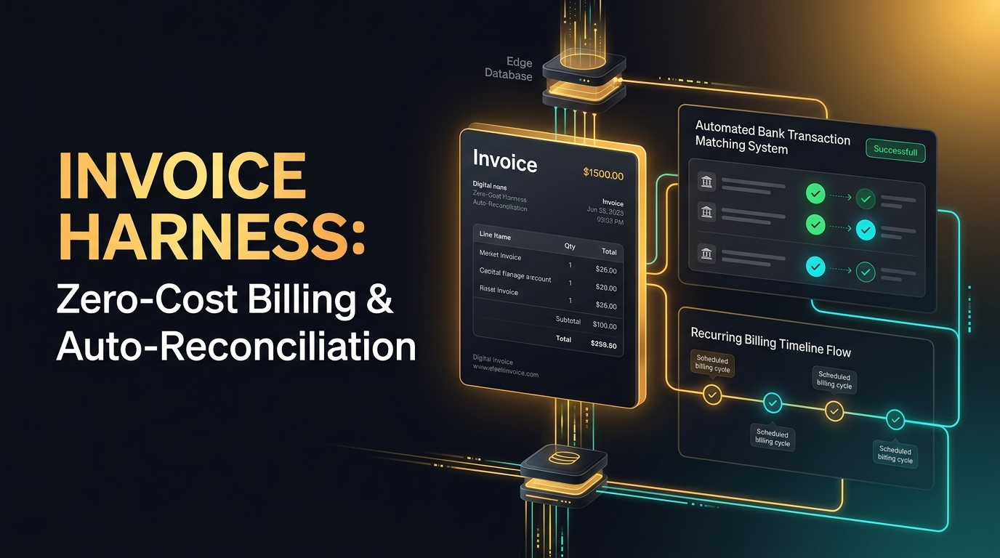

# Invoice Harness 🧾🏦
**Zero-Cost Qualified Invoice (T-Number), Bank Auto-Reconciliation & Dunning Engine on Cloudflare Workers + D1 + MCP**



マネーフォワード クラウド請求書や Misoca、MakeLeaps、入金消込SaaS（月額数千〜数万円＋発行通数課金）を、**Cloudflare Workers + D1 の完全無料枠（月額0円）**で代替するオープンソースの適格請求書（インボイス）発行＆銀行入金AI自動消込エンジンです。

## ✨ 主な特徴
1. **インボイス制度（適格請求書保存方式・T番号）完全対応**: 10%消費税の端数計算・登録番号付きの請求書データをワンクリックで発行。
2. **表記ゆれ＆振込手数料差引に強い「銀行入金AI自動消込」**: `カ）` / `カブシキガイシャ` などの全銀カナ表記ゆれ正規化に加え、先方負担の振込手数料（220円・550円・770円等）が差し引かれて着金した場合も自動検出して消込完了。
3. **スマート督促・入金確認リマインド自動生成**: 期日超過・未入金データの抽出と角が立たない丁寧な確認メール文面を即時生成。
4. **AIエージェント（MCP）完全対応**: Claude Code や Cursor から自然言語で請求発行・入金照合・督促メール作成が可能。

## 🚀 クイックスタート

```bash
git clone https://github.com/reina20xx/invoice-harness.git
cd invoice-harness
npm install

# ローカル開発サーバー起動 (http://localhost:8792)
npm run dev

# E2Eテスト実行
node test-e2e.js
```

## 📄 ライセンス
MIT License
